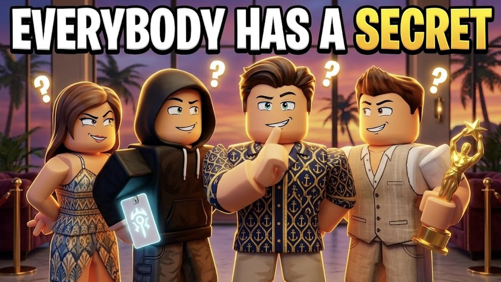

# Everybody Has a Secret (Roblox)

A social-deduction game set in a resort. Every player gets a secret mission, for example stealing the golden statue or framing another guest. Your goal is to finish yours while you collect evidence on the others and accuse them before the reveal.

- **About 24,500 lines of Luau.** This is the biggest project here.
- **Public on Roblox** since October 2026.

## Features
- **Secrets.** Each player gets a main and a side secret across 4 tiers, linked into story chains (one player's secret can target another player). The game avoids repeating the same secret.
- **Evidence and accusations.** Security cameras, deleting footage, framing other players, accusations with penalties for being wrong, and security guards who detain you.
- **Random events.** A power outage, lockdown, storm, jackpot, VIP guest, kitchen fire and a police raid.
- **Bots.** If you play alone, 9 NPC guests fill the server. They get secrets, act on them, can be accused, and appear in the reveal.
- **Progression.** Coins, XP, levels and titles, daily and weekly challenges, stats, DataStore saving, and a cosmetic shop.
- **Procedural map.** The hotel, casino, beach and underground areas are all built from code at runtime (`src/server/Map/`).

## Architecture
`ARCH.md` is the contract I wrote so that three parallel AI builders (map, server, client) could work at the same time without breaking each other's code. It fixes the names, attributes, remotes and payloads for each part.

## How this was built
I designed, directed, play-tested and shipped this project. Most of the code was written with an AI coding agent (Claude, running in the Hermes agent framework) working from my specs and bug reports, and I decided what to build, what to change and when to ship. Knowing how to use an AI agent to get from an idea to a live, tested product is the skill this repo shows.
